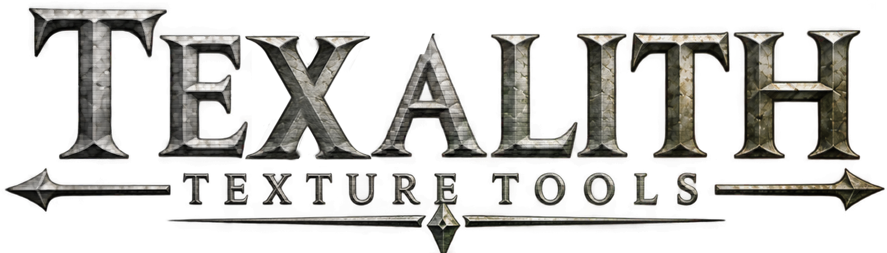

# Texalith

Texalith makes the maps a Skyrim material is missing from the ones you have. It is for texture authors who have a normal or height map and need parallax, AO, curvature or cavity, a normal blended from layers, or a cubemap. It saves 16-bit PNGs; encoding them to DDS is the job of [Tessalith](https://github.com/Alistra-za/Tessalith) or your own converter.

## Start

1. Download `Texalith-<version>-win-x64.zip` from [Releases](https://github.com/Alistra-za/Texalith/releases) and unzip it anywhere. Keep the `cs-shaders` folder beside `texalith.exe`: the 3D preview reads its shaders from there.
2. Run `texalith.exe`. The exe is not code-signed, so Windows SmartScreen may warn on first run: click **More info**, then **Run anyway**.
3. Pick a tab: **Material**, **RNM** or **Cubemap**.
4. Open your file with the tab's open button. The **Material** tab also takes a file dropped on the window.
5. Check the result in the preview, pick a folder under **Save to**, and save.

## What each tab makes

| Tab | You open | It saves |
|---|---|---|
| **Material** | a normal map or a height map | `_parallax`, `_ao`, `_curvature`, `_cavity`, `_height`, and `_n` from a height map |
| **RNM** | a base normal (`_n` or `_cnr`) plus bump, detail and bent-normal layers | one blended normal, named after the base |
| **Cubemap** | a panorama, cross, strip, mirror ball, angular map, photo or six face files | `<name>_e.png`, a 6:1 strip of the six faces |

Every setting, with what it changes and when to touch it, is in the [guide](docs/Guide.md).

## What you can rely on

- Texalith never writes over a file you opened. On the **RNM** and **Cubemap** tabs an output that would take a source's name is saved under the first free numbered name (`rock_n1.png`). Other files already in the folder are kept unless you choose **Overwrite** ([Saving](docs/Guide.md#saving)).
- The 3D preview uses Community Shaders' own shader files, a pinned copy with fixed settings, so a map looks the same on every machine. The build is shown under **Community Shaders** in the **Preview** panel.
- Each PNG records how it was made: the source's path and hash and every setting, in a text chunk of the file.

## Requirements

- Windows 10 or 11, x64.
- A graphics card for the 3D preview. Without one Texalith draws in software and shows "Software rendering: the preview will be slow."
- Nothing to install.

## Build from source

1. Clone Texalith: `git clone https://github.com/Alistra-za/Texalith`
2. In that folder: `cargo run --release`

Cargo fetches Tessalith's crates at the commit pinned in `Cargo.toml`. The Rust version is pinned in `rust-toolchain.toml`. `tools\package-release.ps1` builds the release zip.

## Licence

GPL-3.0-only, see [LICENSE](LICENSE). Third-party code and the bundled Community Shaders files: [THIRD_PARTY_NOTICES.md](THIRD_PARTY_NOTICES.md). Changes per version: [CHANGELOG.md](CHANGELOG.md).

Next: open the [guide](docs/Guide.md) at the tab you need.
